# Lakehouse with Databricks, Backblaze B2, Delta Lake and PySpark

Complete reconstruction of the workshop **Atelier Big Data – 4** (*Architecture
Lakehouse avec Databricks, Backblaze B2, Delta Lake et PySpark*, 59 pages):
four CSV files are loaded from a Backblaze B2 bucket into Databricks, cleaned
through a **bronze → silver → gold** medallion architecture with PySpark and
Delta Lake, then exported back to B2 and visualised in a Databricks dashboard.

This repository gives you everything needed to rebuild the project by hand:

* the **six notebooks** of the workshop, ready to import in Databricks
  (`notebooks/00_config.py` … `notebooks/05_export_gold_b2.py`) plus the
  **job definition** that chains them;
* the **sample data** (`data/csv/`, four CSVs, 20/13/30/64 rows) so you can
  reproduce every number in the guide;
* the **SQL datasets** used by the dashboard (`sql/dashboard/`);
* **130 screenshots** extracted from the PDF (`images/`), referenced step by
  step below;
* a short **architecture diagram** (`docs/architecture.png`).

Everything is written for Databricks Free Edition, so it runs without a paid
workspace, except the B2 bucket you create yourself.

---

## Table of contents

1. [What the pipeline does](#1-what-the-pipeline-does)
2. [Repository layout](#2-repository-layout)
3. [Prerequisites](#3-prerequisites)
4. [Step 1 — Create the Databricks account and workspace](#step-1--create-the-databricks-account-and-workspace)
5. [Step 2 — Create the schemas](#step-2--create-the-schemas)
6. [Step 3 — Create the Backblaze B2 bucket, key and endpoint](#step-3--create-the-backblaze-b2-bucket-key-and-endpoint)
7. [Step 4 — Connect Databricks to B2](#step-4--connect-databricks-to-b2)
8. [Step 5 — Configure the pipeline (00_config)](#step-5--configure-the-pipeline-00_config)
9. [Step 6 — Ingest the CSVs from B2 (01_ingestion_b2)](#step-6--ingest-the-csvs-from-b2-01_ingestion_b2)
10. [Step 7 — Bronze and Silver (02, 03)](#step-7--bronze-and-silver-02-03)
11. [Step 8 — Gold layer (04)](#step-8--gold-layer-04)
12. [Step 9 — Export gold back to B2 (05)](#step-9--export-gold-back-to-b2-05)
13. [Step 10 — Automate with a Databricks Job](#step-10--automate-with-a-databricks-job)
14. [Step 11 — Verify and build the dashboard](#step-11--verify-and-build-the-dashboard)
15. [Notebook reference](#notebook-reference)
16. [Data model](#data-model)
17. [Expected results](#expected-results)
18. [Troubleshooting](#troubleshooting)
19. [Security notes](#security-notes)

---

## 1. What the pipeline does

```
Backblaze B2 bucket (CSV)            Databricks workspace
        │                                    │
        │  boto3 download                    │
        ▼                                    ▼
┌──────────────────┐   ┌─────────┐   ┌─────────┐   ┌─────────┐   ┌─────────┐
│ 01_ingestion_b2  │──▶│ bronze  │──▶│ silver  │──▶│  gold   │──▶│ 05_export│
│ raw files        │   │ as-is   │   │ typed,  │   │ KPIs    │   │ to B2   │
│ → /Volumes/…     │   │ Delta   │   │ dedup,  │   │ 4 tables│   │ + dashb.│
└──────────────────┘   └─────────┘   │ DQ tests│   └─────────┘   └─────────┘
                                     └─────────┘
```

* **Bronze** — the four CSVs are read as text (`inferSchema=false`) and stored
  as Delta tables, without any transformation.
* **Silver** — explicit typing (dates in several formats, decimal prices, ints),
  empty strings turned into `NULL`, deduplication on business keys, and 15
  quality checks (uniqueness, non-null, referential integrity) written to a
  `bilan_tests` table.
* **Gold** — four analytics tables: sales facts, monthly revenue, revenue per
  category, revenue per client.
* **Export** — the gold tables are written as CSV into the B2 bucket.
* **Dashboard** — four SQL datasets feed the bars, KPIs and table of the
  dashboard.

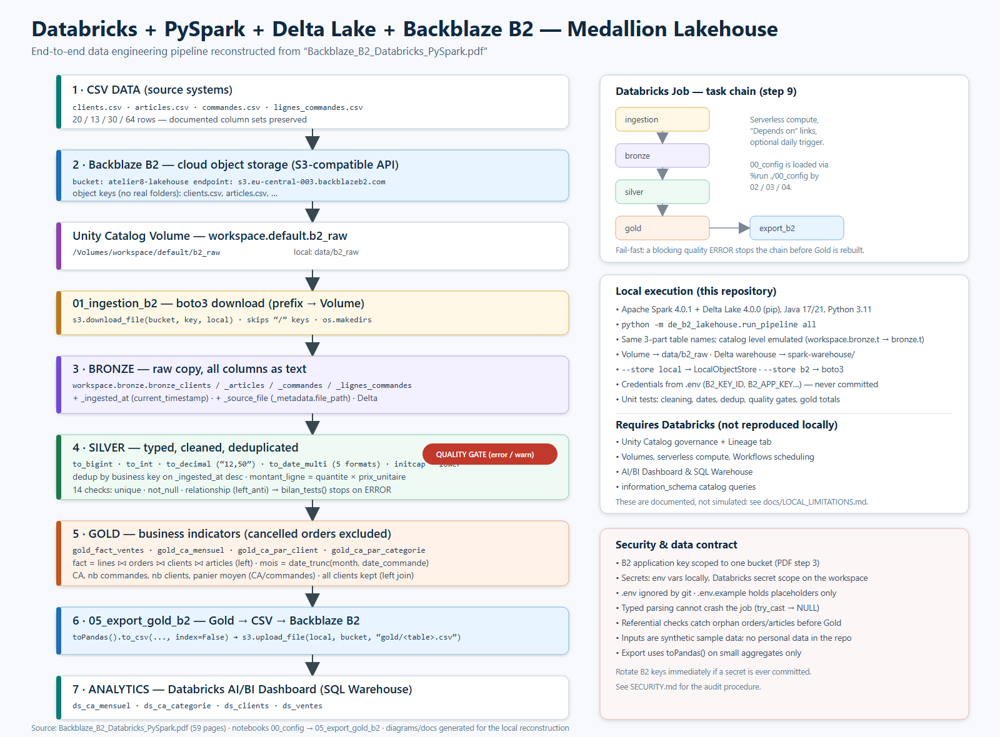

---

## 2. Repository layout

```
databricks-end-to-end-data-engineering/
├── README.md
├── notebooks/
│   ├── 00_config.py              # parameters + shared helper functions
│   ├── 01_ingestion_b2.py        # boto3: B2/local → Volume
│   ├── 02_bronze.py              # CSV → bronze Delta tables
│   ├── 03_silver.py              # typing, cleaning, dedup, quality tests
│   ├── 04_gold.py                # 4 analytical tables
│   ├── 05_export_gold_b2.py      # gold CSV → B2 bucket
│   └── job_definition.json       # 5-task Databricks job
├── data/csv/                     # the 4 sample CSVs (20/13/30/64 rows)
├── sql/dashboard/                # ds_ca_mensuel, ds_ca_categorie, ds_clients, ds_ventes
├── images/                       # 130 screenshots taken from the PDF
├── docs/architecture.png|svg|mmd
├── requirements-databricks.txt   # libraries used on the cluster
├── requirements.txt              # same versions, for reference
├── .env.example                  # the secrets you must provide
└── .gitignore
```

---

## 3. Prerequisites

| What | Why |
|------|-----|
| A Databricks account (Free Edition is enough) | notebooks, SQL warehouse, dashboards |
| A Backblaze B2 account (free 10 GB) | object storage for the raw CSVs |
| The four CSV files | provided in `data/csv/` |
| No local installation | everything runs in the browser |

> The notebooks read credentials from **environment variables / notebook widgets**
> (section 3 of `00_config.py`), not from hard-coded strings. Put your B2 key in a
> Databricks secret scope or a widget before running the ingestion step.

---

## Step 1 — Create the Databricks account and workspace

Create a Free Edition account, then open a workspace. Two screenshots show the
sign-up flow and the workspace home.

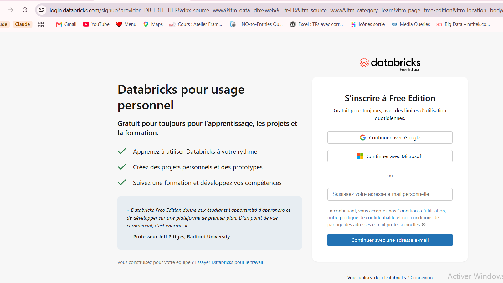
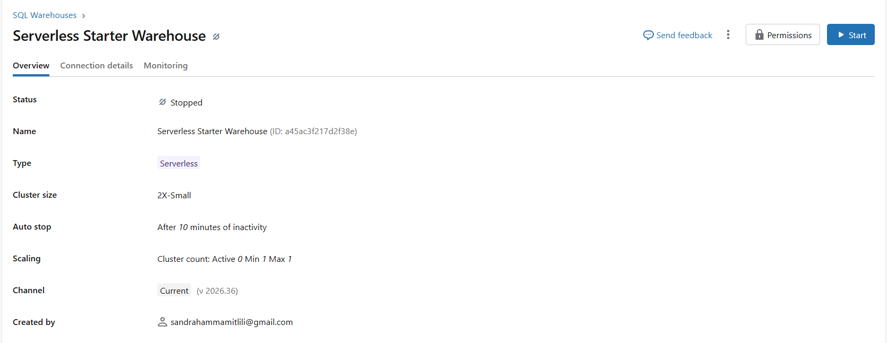

---

## Step 2 — Create the schemas

In the **SQL Editor**, create the three schemas of the medallion architecture and
a Volume that will receive the raw files:

```sql
CREATE SCHEMA IF NOT EXISTS workspace.bronze;
CREATE SCHEMA IF NOT EXISTS workspace.silver;
CREATE SCHEMA IF NOT EXISTS workspace.gold;

CREATE VOLUME IF NOT EXISTS workspace.default.b2_raw;
```


---

## Step 3 — Create the Backblaze B2 bucket, key and endpoint

1. **Buckets → Create a Bucket** — the workshop uses `atelier8-lakehouse`
   (Private is fine for a training project).
2. **Application Keys → Add a New Application Key** — name it
   `atelier8-databricks`, restrict it to that bucket, and copy the
   `keyID` / `applicationKey` immediately: the secret is shown once.
3. Copy the **S3 endpoint** of the bucket, e.g.
   `s3.eu-central-003.backblazeb2.com`.
4. Upload the four CSVs; **Files** must show **4** files.

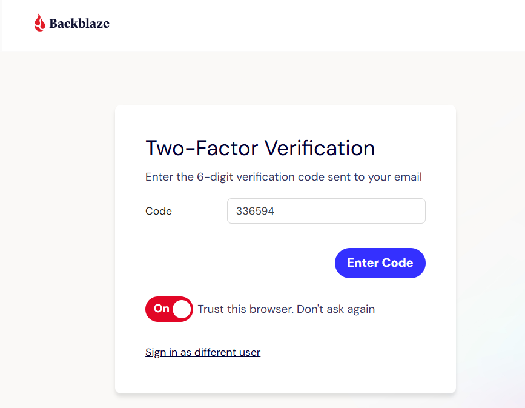
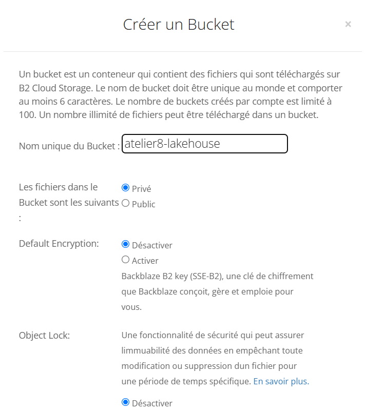
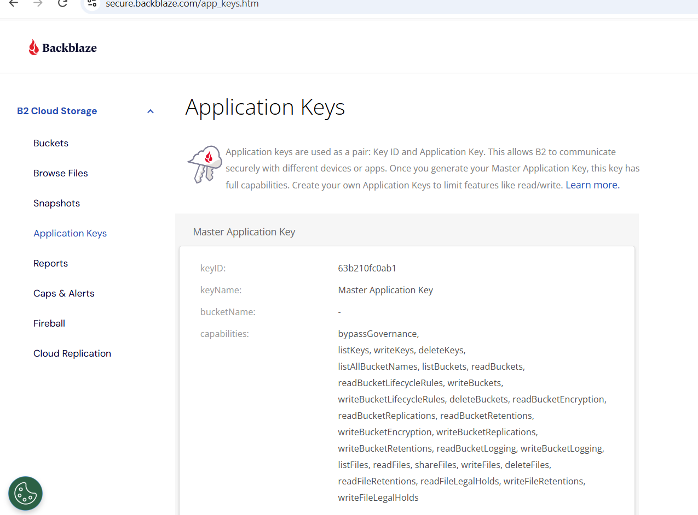
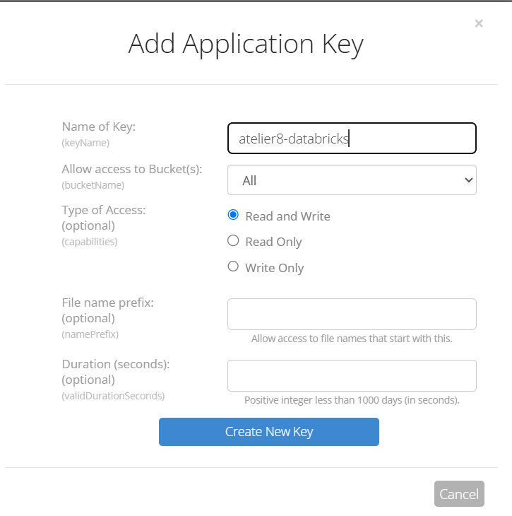
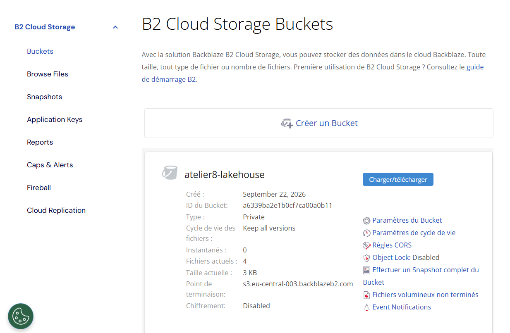
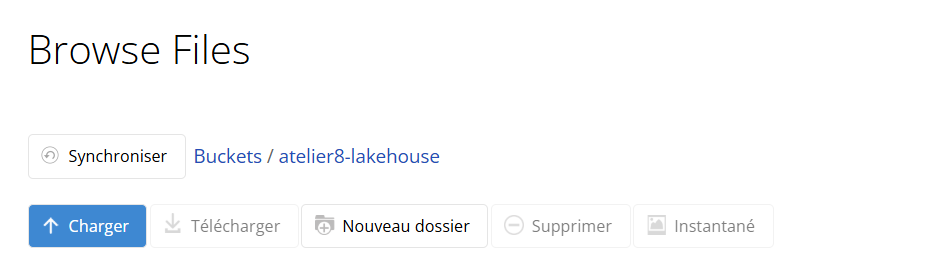

The CSVs and their columns:

| File | Columns |
|------|---------|
| `clients.csv` | `id_client, nom, ville, date_creation` |
| `articles.csv` | `id_article, designation, categorie, prix` |
| `commandes.csv` | `id_commande, id_client, date_commande, statut` |
| `lignes_commandes.csv` | `id_commande, id_article, quantite, prix_unitaire` |

---

## Step 4 — Connect Databricks to B2

The Volume `workspace.default.b2_raw` is mounted at
`/Volumes/workspace/default/b2_raw`. Inside `01_ingestion_b2`:

* `boto3.client("s3", endpoint_url=B2_ENDPOINT, aws_access_key_id=…,
  aws_secret_access_key=…)` connects to B2 with the S3 protocol;
* `list_objects_v2` lists the keys, `download_file` copies each CSV into the
  Volume, and `upload_file` sends the gold export back at the end.

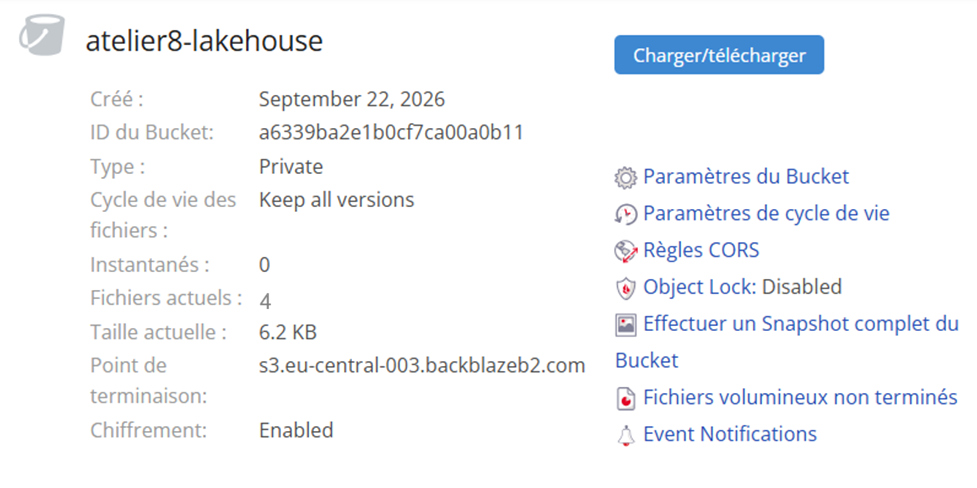
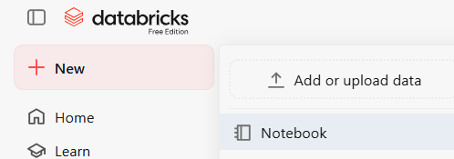

---

## Step 5 — Configure the pipeline (00_config)

`notebooks/00_config.py` holds **no data**, only parameters and shared helpers:

```python
CATALOG   = "workspace"
RAW_PATH  = "/Volumes/workspace/default/b2_raw"
CSV_SEP   = ","
BRONZE    = f"{CATALOG}.bronze"
SILVER    = f"{CATALOG}.silver"
GOLD      = f"{CATALOG}.gold"

B2_ENDPOINT = "https://s3.eu-central-003.backblazeb2.com"
B2_BUCKET   = "<your-bucket>"      # e.g. atelier8-lakehouse
```

Shared helpers reused by the other notebooks:

| Helper | Role |
|--------|------|
| `read_raw(name)` | read a CSV from the Volume with header, `inferSchema=false` |
| `save_table(df, name)` | overwrite-write a Delta table |
| `to_decimal(col)` / `to_int(col)` / `to_bigint(col)` | cast French-style numbers (`12,50`, `1 200`) |
| `to_date_multi(col)` | parse several date formats (`dd/MM/yyyy`, `yyyy-MM-dd`, …) |
| `clean_str(col)` | trim, empty string → `NULL` |
| `dedup(df, keys)` | `dropDuplicates` on business keys |
| `test_unique`, `test_not_null`, `test_relationship` | quality checks writing to `bilan_tests` |

Every other notebook starts with `%run ./00_config`.

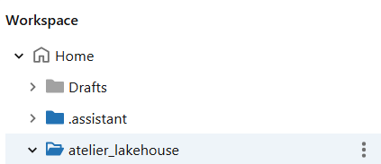
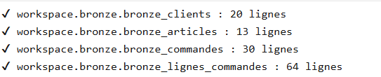

---

## Step 6 — Ingest the CSVs from B2 (01_ingestion_b2)

`01_ingestion_b2.py` lists the bucket, downloads the four files to
`/Volumes/workspace/default/b2_raw`, then reads them and saves
`workspace.bronze.bronze_clients`, `bronze_articles`, `bronze_commandes`,
`bronze_lignes_commandes`.

No B2 account yet? Upload the files from `data/csv/` directly into the Volume
with *Catalog → b2_raw → Upload*, and skip the download loop: the bronze
notebook reads the CSV from the Volume, not from S3.

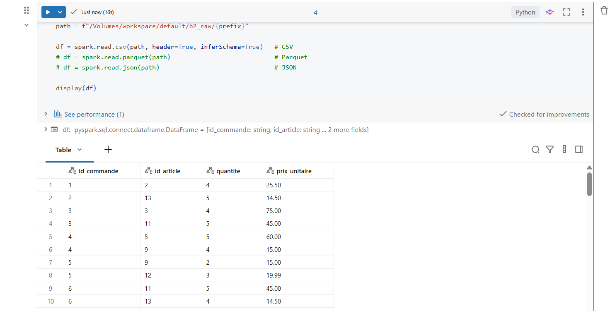
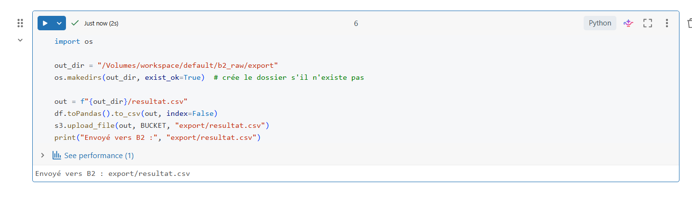

---

## Step 7 — Bronze and Silver (02, 03)

**02_bronze.py** is deliberately trivial: raw text columns, no typing, so that
nothing is lost and the layer can be replayed.

**03_silver.py** does the real work, in this order:

1. select and cast the columns (`to_decimal`, `to_int`, `to_date_multi`,
   `clean_str`);
2. deduplicate on business keys (`id_client`, `id_article`, `id_commande`,
   and `(id_commande, id_article)` for the lines);
3. run the quality checks and write `workspace.silver.bilan_tests`.

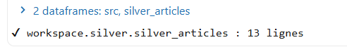
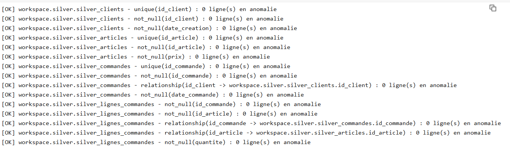


---

## Step 8 — Gold layer (04)

Four tables, computed from silver:

| Table | Grain | Measure |
|-------|-------|---------|
| `gold_fact_ventes` | one line of an order | `montant_ligne = quantite × prix_unitaire` |
| `gold_ca_mensuel` | month | revenue, orders, clients, average basket |
| `gold_ca_par_categorie` | article | revenue per category/article |
| `gold_ca_par_client` | client (all 20, left join) | revenue, orders, average basket (`NULL` if none) |

Business rules kept from the source document:

* cancelled orders are excluded: `~coalesce(statut, "").like("annul%")`;
* `montant_ligne` is computed **after** deduplication of `(id_commande, id_article)`;
* `panier_moyen = round(CA / nb_commandes, 2)`;
* clients with no order stay in `gold_ca_par_client` with `0` / `NULL`.

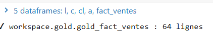
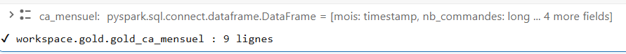

---

## Step 9 — Export gold back to B2 (05)

`05_export_gold_b2.py` writes each gold table to a single CSV in the Volume,
then uploads it under the `gold/` prefix of the bucket with `boto3`.

```python
out_dir = "/Volumes/workspace/default/b2_raw/export"
prefix  = "gold/"
```

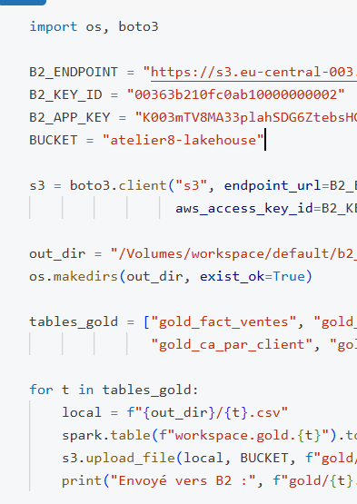
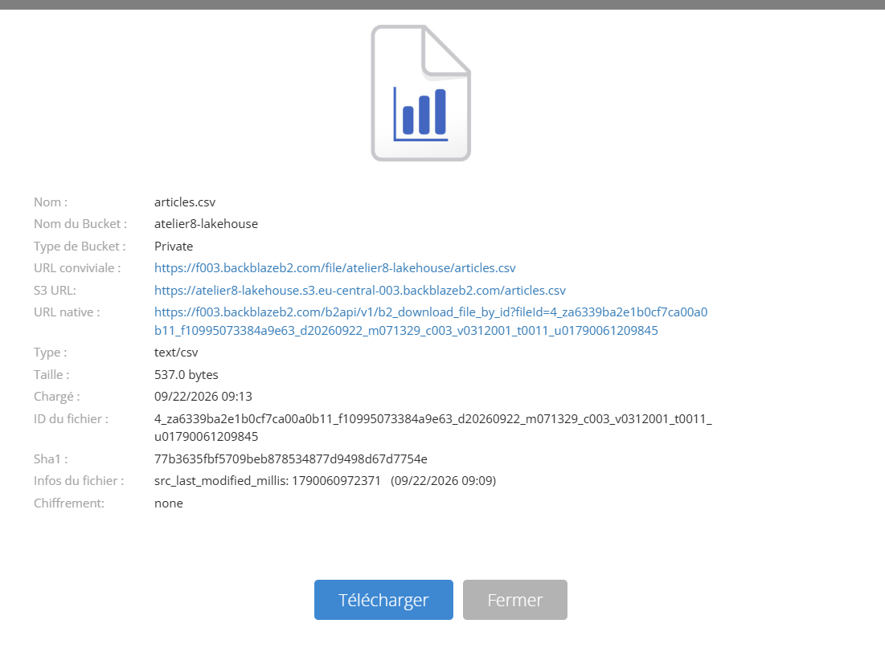
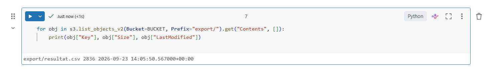

---

## Step 10 — Automate with a Databricks Job

Import `notebooks/job_definition.json`, or create the job by hand — five tasks,
each depending on the previous one:

```
ingestion (01) → bronze (02) → silver (03) → gold (04) → export_b2 (05)
```

Serverless compute, daily trigger optional (it is paused in the provided
definition).

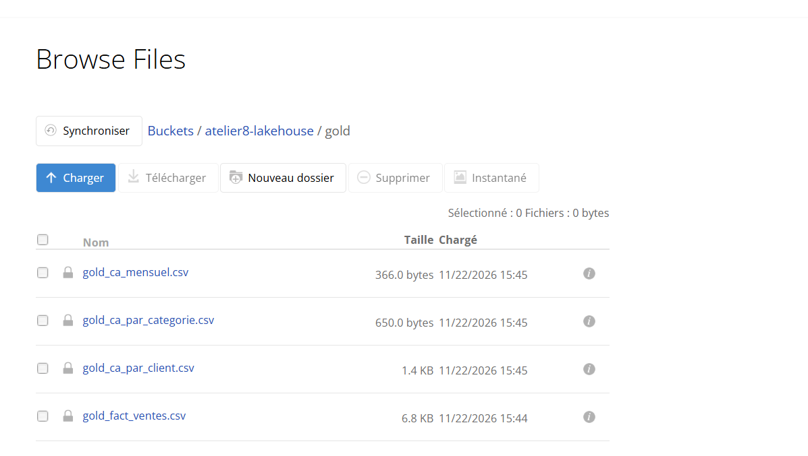
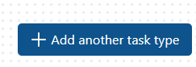
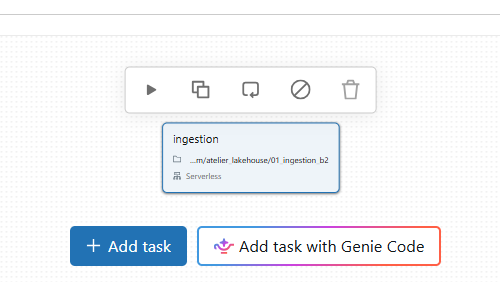
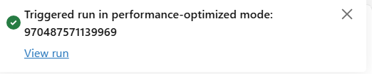

---

## Step 11 — Verify and build the dashboard

Check the Catalog: `workspace.bronze`, `workspace.silver`, `workspace.gold` and
the row counts.

```sql
SELECT table_schema, table_name, comment
FROM workspace.information_schema.tables
WHERE table_schema IN ('bronze','silver','gold')
ORDER BY table_schema, table_name;
```

Then create a dashboard, add the four datasets from `sql/dashboard/`, build the
widgets (revenue per month, revenue per category, top clients, sales table) and
publish it.

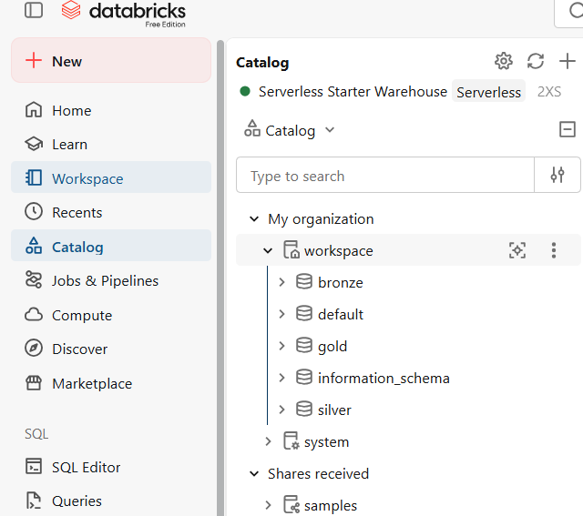
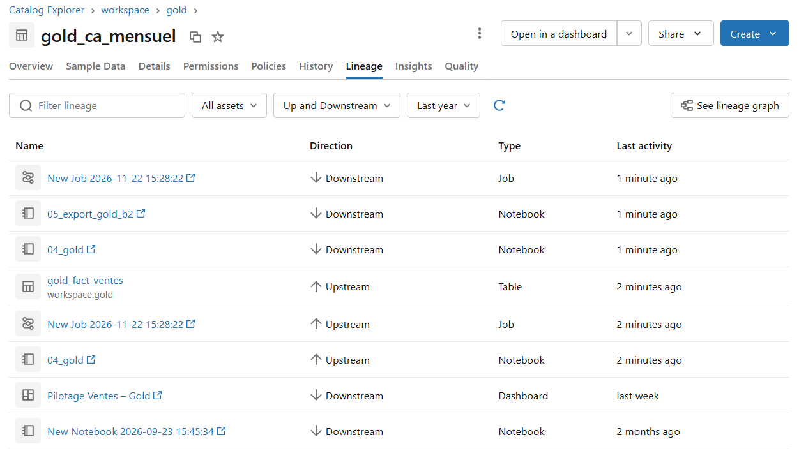
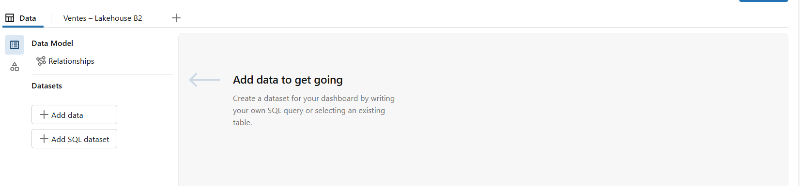
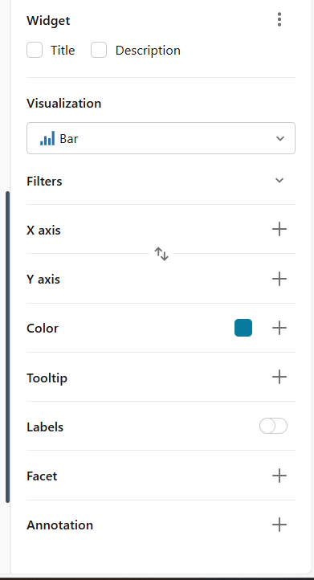

---

## Notebook reference

| Notebook | Lines of logic | What it contains |
|----------|----------------|------------------|
| `00_config.py` | parameters + 12 helpers | paths, schemas, type casters, date parser, DQ test functions |
| `01_ingestion_b2.py` | B2 → Volume | boto3 client, `list_objects_v2`, download loop, optional local store |
| `02_bronze.py` | CSV → Delta | four `read_raw` + `save_table` blocks |
| `03_silver.py` | typing + DQ | four silver tables, dedup, 15 checks, `bilan_tests` |
| `04_gold.py` | 4 KPIs | joins, filters, aggregations |
| `05_export_gold_b2.py` | export | `toPandas`/`coalesce(1)` CSV write + `upload_file` |

All notebooks are plain `.py` files in Databricks **source** format (cells
separated by `# COMMAND ----------`): import them with
*Workspace → Import → File*, they open as notebooks.

---

## Data model

```
clients(id_client, nom, ville, date_creation)
articles(id_article, designation, categorie, prix)
commandes(id_commande, id_client, date_commande, statut)
lignes_commandes(id_commande, id_article, quantite, prix_unitaire)
```

```
clients 1 ──── n commandes 1 ──── n lignes_commandes n ──── 1 articles
```

---

## Expected results

With the CSVs in `data/csv/` (same files as in the workshop):

| Table | Rows |
|-------|------|
| `bronze_clients` / `silver_clients` | 20 |
| `bronze_articles` / `silver_articles` | 13 |
| `bronze_commandes` / `silver_commandes` | 30 |
| `bronze_lignes_commandes` / `silver_lignes_commandes` | 64 |
| `gold_fact_ventes` | 64 |
| `gold_ca_mensuel` | 9 |
| `gold_ca_par_categorie` | 13 |
| `gold_ca_par_client` | 20 |

Revenue totals (cancelled orders excluded, 2024-01 → 2024-09):

| Month | Orders | Revenue |
|-------|--------|---------|
| 2024-01 | 1 | 394.50 |
| 2024-02 | 5 | 1 413.46 |
| … | … | … |
| 2024-09 | 1 | 5 268.46 |
| **Total** | **23** | **14 574.15** |

15 of the 20 clients have revenue; 5 have none (`0` orders, `NULL` basket).

---

## Troubleshooting

| Symptom | Cause | Fix |
|---------|-------|-----|
| `NoSuchBucket` / `403` | wrong endpoint or key permissions | copy the endpoint from *Buckets → Buckets settings*; give the key read/write on that bucket only |
| `Path does not exist: /Volumes/...` | Volume not created | run `CREATE VOLUME IF NOT EXISTS workspace.default.b2_raw` |
| `TABLE_OR_VIEW_NOT_FOUND workspace.bronze.…` | schemas missing or notebook run out of order | create the schemas (step 2) and run notebooks 00 → 05 in order |
| empty dates in silver | unexpected date format | add the format to `to_date_multi` |
| `bilan_tests` shows `KO` on relationships | a line references an unknown order/article | expected on dirty data; the notebook only warns |
| export CSV is split into many files | `coalesce(1)` missing | write with `.coalesce(1)` before the CSV export |

---

## Security notes

* Never commit `keyID` / `applicationKey`. Use a Databricks **secret scope**
  (`dbutils.secrets.get`) or the widget placeholders from `00_config.py`.
* `data/csv/` is fictional sample data; `images/` comes from the workshop PDF.
* The B2 application key should be limited to the workshop bucket, with
  read/write and no account-wide permissions.
* Rotate the key after the workshop — it appears in notebook history if you
  typed it in a cell.

## License

MIT. Screenshots belong to the original workshop document and are included for
pedagogical use.
